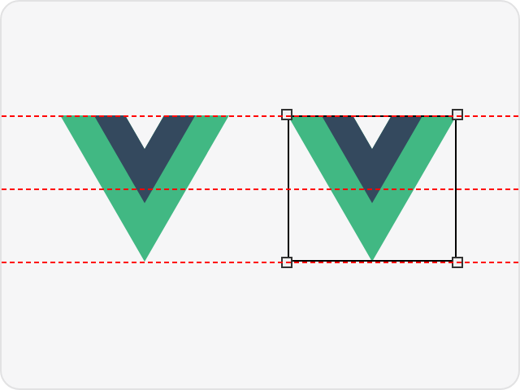

<p align="center">
  <picture>
    <source media="(prefers-color-scheme: dark)" srcset="docs/public/hero-dark.png">
    
  </picture>
</p>

<h1 align="center">vue-drag-resize-kit</h1>

<div align="center">

[](https://www.npmjs.com/package/vue-drag-resize-kit)
[](LICENSE)
[](https://vuejs.org)
[](https://vbentec.github.io/vue-drag-resize-kit/)

</div>

> Draggable and resizable component for Vue 3, with snapping, alignment guides and first-class
> TypeScript support.

- Drag and resize with mouse, touch and pen (Pointer Events)
- Restrict movement and size to the parent element, or cap the size at any `boundary` element
- Min / max sizes, locked axes, locked aspect ratio
- Snapping to other elements, the parent and custom guides, drawn live while dragging
- Flow layout for content that stays in the document flow (inline editor images), with natural
  content sizing
- Right-to-left aware: logical (inline-start / inline-end) handles and flow anchoring
- Keyboard resizing and moving, ARIA semantics, forced-colors styles and enlargeable pointer
  targets
- Fully typed props, events and `v-model`s
- No runtime dependencies, ESM, SSR-safe, themeable with CSS custom properties

**[Documentation and live demos →](https://vbentec.github.io/vue-drag-resize-kit/)**

## Installation

```bash
npm install vue-drag-resize-kit
```

Requires Vue 3.5 or newer. The package is ESM only.

## Usage

```vue
<script setup lang="ts">
import { ref } from 'vue'
import { DraggableResizable } from 'vue-drag-resize-kit'

import 'vue-drag-resize-kit/style.css'

const x = ref(100)
const y = ref(100)
const w = ref(120)
const h = ref(80)
</script>

<template>
  <div style="position: relative; width: 400px; height: 300px">
    <DraggableResizable v-model:x="x" v-model:y="y" v-model:w="w" v-model:h="h" parent>
      Drag me
    </DraggableResizable>
  </div>
</template>
```

The element is absolutely positioned, so its parent needs a non-static position. Wrap elements in
a `DraggableContainer` to make them snap to each other and to guides.

## Documentation

- [Getting started](https://vbentec.github.io/vue-drag-resize-kit/guide/getting-started)
- Guides: [constraints and handles](https://vbentec.github.io/vue-drag-resize-kit/guide/constraints),
  [models and events](https://vbentec.github.io/vue-drag-resize-kit/guide/events),
  [toolbar](https://vbentec.github.io/vue-drag-resize-kit/guide/toolbar) (`#toolbar` slot, `resizeTo`), [snapping](https://vbentec.github.io/vue-drag-resize-kit/guide/snapping),
  [flow layout](https://vbentec.github.io/vue-drag-resize-kit/guide/flow-layout) (inline editor images), [boundary](https://vbentec.github.io/vue-drag-resize-kit/guide/boundary),
  [right-to-left text](https://vbentec.github.io/vue-drag-resize-kit/guide/rtl), [styling](https://vbentec.github.io/vue-drag-resize-kit/guide/styling),
  [accessibility](https://vbentec.github.io/vue-drag-resize-kit/guide/accessibility), [TypeScript](https://vbentec.github.io/vue-drag-resize-kit/guide/typescript),
  [SSR / Nuxt](https://vbentec.github.io/vue-drag-resize-kit/guide/ssr)
- API: [`DraggableResizable`](https://vbentec.github.io/vue-drag-resize-kit/api/draggable-resizable),
  [`DraggableContainer`](https://vbentec.github.io/vue-drag-resize-kit/api/draggable-container), [CSS](https://vbentec.github.io/vue-drag-resize-kit/api/css),
  [types](https://vbentec.github.io/vue-drag-resize-kit/api/types)
- Migrating: [from `vue3-draggable-resizable`](https://vbentec.github.io/vue-drag-resize-kit/migration/from-vue3-draggable-resizable),
  [from 1.0 integration overrides](https://vbentec.github.io/vue-drag-resize-kit/migration/from-1-0-overrides)
- [Changelog](CHANGELOG.md)
- For AI assistants: [llms.txt](https://vbentec.github.io/vue-drag-resize-kit/llms.txt), [llms-full.txt](https://vbentec.github.io/vue-drag-resize-kit/llms-full.txt)

## Development

```bash
pnpm install
pnpm dev-vue     # playground
pnpm docs:dev    # documentation site
pnpm test        # unit, component and type tests (happy-dom)
pnpm exec playwright install chromium
pnpm test:browser # real-browser tests (Chromium)
pnpm typecheck
pnpm lint && pnpm fmt:check
pnpm build && pnpm check:pkg
```

`src/core` holds the framework-agnostic geometry (limits, resizing, snapping); `src/vue` holds
the components and composables built on it. Only `src/index.ts` is public API. The documentation
lives in `docs/`.

See [RELEASE.md](RELEASE.md) for how to cut a release.

## Credits

Originally forked from
[a7650/vue3-draggable-resizable](https://github.com/a7650/vue3-draggable-resizable) by ZZP. The
current code base is a full rewrite.

## License

[MIT](LICENSE)
